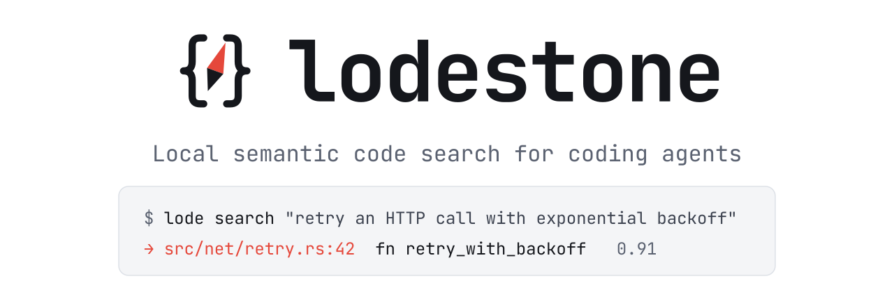

<p align="center">
  <picture>
    <source media="(prefers-color-scheme: dark)" srcset="assets/branding/readme-header-dark.svg">
    
  </picture>
</p>

Ask "where in this codebase do we do X?" and get the function, not a grep hit. lodestone indexes
your repositories locally and gives Claude Code, Codex and you semantic code search in well under
a second.

## Features

- **Finds definitions:** results are functions, types and methods, parsed with tree-sitter.
- **16 languages built in:** Rust, Python, TypeScript/JavaScript, Svelte, Go, Java, C, C++, C#,
  Ruby, PHP, Lua, Elixir, Swift, Clarity and Markdown. Add more without code.
- **Runs locally:** embeddings are computed on your machine (Metal GPU on macOS), so your code
  stays there.
- **Always fresh:** a background daemon re-indexes on file changes, for every repository and
  worktree.
- **Cheap worktrees:** a shared embedding cache means a new worktree re-embeds only what changed.
- **Agent-ready:** one command sets up Claude Code and Codex: MCP tools, a skill and reminders.

## Install

macOS and Linux (x86_64, arm64):

```bash
curl --proto '=https' --tlsv1.2 -LsSf https://github.com/cylewitruk/lodestone/releases/latest/download/lodestone-cli-installer.sh | sh
```

Windows (x86_64):

```powershell
powershell -ExecutionPolicy Bypass -c "irm https://github.com/cylewitruk/lodestone/releases/latest/download/lodestone-cli-installer.ps1 | iex"
```

With Cargo ([crates.io](https://crates.io/crates/lodestone-cli); needs a C compiler and takes a few
minutes):

```bash
cargo install --locked lodestone-cli
```

Archives and checksums are on the [releases page](https://github.com/cylewitruk/lodestone/releases).

**Upgrading:** install the new version the same way, then run `lode stop` so the next command
starts the new daemon.

## Quick start

```bash
lode register ~/src/my-repo        # index a repository
lode install                       # set up Claude Code and/or Codex
lode search "retry an HTTP call with exponential backoff"
```

There is nothing to keep running: the daemon starts when needed and exits when idle. The model
(about 300 MB) downloads on first use.

## Writing queries

Describe what the code does in one sentence, then guess a few names in the codebase's style.
Wrong guesses still help.

```bash
lode search 'parse a duration such as "5m" into seconds. parse_duration duration_from_str'
```

Results, one per line:

```text
stacks-common/src/util/retry.rs:25:12  lines 25-29  pub struct RetryReader<'a, R: Read>  — Wrap a Read so that we store a copy of what was read.
```

## With coding agents

```bash
lode install                       # every agent CLI on PATH, for your user
lode install --scope project       # files to commit in this repository instead
```

Agents get three MCP tools:

| Tool | Finds |
| ---- | ---- |
| `semantic_code_search` | code by what it does |
| `similar_code_search` | code that does the same job as given code, e.g. before writing a helper |
| `status` | how fresh the index is |

In our evaluation (28 tasks, 48 runs per setup), Opus 5.5 got 43/48 right with lodestone and
27/48 without. See [docs/agents.md](docs/agents.md) for what `lode install` changes,
the tool inputs and `lode transcript-stats`.

## Commands

| Command | Does |
| ---- | ---- |
| `lode register [path]` | add, watch and index a repository or worktree |
| `lode search <query>` | search the current repository |
| `lode status` | index freshness |
| `lode index [--force]` | re-index the current repository |
| `lode install` / `uninstall` | set up or remove the agent integration |
| `lode stop` | stop the daemon |
| `lode serve` | run the daemon in the foreground, always on |
| `lode models` / `languages` | list models and grammars |

`lode <command> --help` for the details.

## Documentation

| Page | Covers |
| ---- | ---- |
| [Agents](docs/agents.md) | `lode install`, MCP tools, result format, usage statistics |
| [Configuration](docs/configuration.md) | `config.toml`, models, backends, languages |
| [Daemon](docs/daemon.md) | lifecycle, worktrees, ignored files, REST API |
| [Evaluation](docs/evaluation.md) | measuring retrieval and agent quality |
| [Releasing](docs/releasing.md) | how versions are published |
| [Changelog](CHANGELOG.md) | changes per release |
| [Decision log](docs/decision-log.md) | measurements and design decisions |

## License

MIT or Apache-2.0, at your option. The vendored Clarity grammar is MIT
([vendor/tree-sitter-clarity/LICENSE](vendor/tree-sitter-clarity/LICENSE)).
