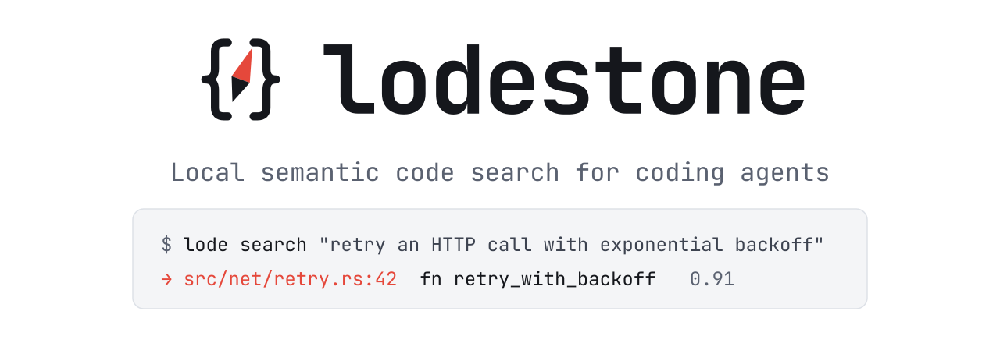

<p align="center">
  <picture>
    <source media="(prefers-color-scheme: dark)" srcset="assets/branding/readme-header-dark.svg">
    
  </picture>
</p>

Local semantic code search for coding agents. One daemon per machine indexes any number of
repositories and worktrees, keeps them fresh from file events, and answers "what in this codebase
does X?" over MCP and HTTP in well under a second.

- **Definitions, not chunks:** tree-sitter tags queries for Rust, Python, TypeScript/JavaScript,
  Go, Clarity and Markdown; any other grammar through tree-sitter's own config.
- **Embeddings:** jina-embeddings-v2-base-code on GPU (Metal) or CPU. A reranker and BM25 fusion
  are available but off by default.
- **Shared cache:** a content-addressed embedding cache, so another worktree of the same
  repository costs only chunking and hashing.
- **Agent-ready:** MCP tools, a skill and a session reminder for Claude Code and Codex, installed
  with one command.

## Quick start

Requires a stable Rust toolchain (edition 2024) and a C compiler.

```bash
cargo install --path .
lode register ~/src/my-repo       # index a repository
lode install                      # wire up Claude Code and/or Codex
lode search "retry an HTTP call with exponential backoff"
```

There is nothing to start: `lode` and agent sessions start the daemon on demand, and it exits
when they are done (see [Daemon](#daemon)). Models download on first use into `~/.lodestone/models`.

## Writing queries

One sentence on what the code does, then a few guessed function or type names. Wrong guesses
still help.

```text
parse a duration such as "5m" or "2h" into seconds. parse_duration duration_from_str
```

## Agent integration

```bash
lode install                      # every harness whose CLI is on PATH, user scope
lode install --client codex       # one harness (repeat --client for several)
lode install --scope project      # files to commit in the current repository
lode uninstall                    # same flags; --dry-run prints the steps only
```

| Part | User scope | Project scope |
| ---- | ---- | ---- |
| Skill | `~/.agents/skills/lodestone/`, linked from `~/.claude/skills/` | `.agents/skills/lodestone/`, linked from `.claude/skills/` |
| MCP server (`lode mcp`) | `claude mcp add` / `~/.codex/config.toml` | `.mcp.json` / `.codex/config.toml` |
| SessionStart reminder | `~/.claude/settings.json` / `~/.codex/hooks.json` | `.claude/settings.json` / `.codex/hooks.json` |

- **Skill location:** the shared `.agents/skills/`. Claude Code doesn't read a repository's
  `.agents/skills`, so it gets a symlink from `.claude/skills/`.
- **MCP server:** `lode mcp`, a stdio relay the harness starts per session. It starts the daemon
  if needed and searches the session's repository when a call names none.
- **Approval:** the tools only read the index and are marked read-only (`readOnlyHint`). For
  Codex, `lode install` sets `default_tools_approval_mode = "approve"` on the server, so its
  approver doesn't stop each search.
- **Reminder:** `lode hook session-start` prints it only in a registered repository, and starts
  the daemon early so the model loads while the session starts.
- **First use:** Codex asks you to trust the hook once (`/hooks`). At project scope, Codex must
  trust the project and Claude Code asks you to approve the `.mcp.json` server.
- **Plugin:** `plugin/` bundles the same skill, server and hook as a Claude Code plugin
  (`claude --plugin-dir plugin`); its hook needs `lode` on PATH.

**Measured effect** (Opus 5.5, details in [eval/situations/README.md](eval/situations/README.md)):

- 28 tasks on stacks-core and LibreChat, 48 runs per arm: correct 27/48 with no help, 37/48 with
  advice alone, 43/48 with the plugin, with 7% shorter runs.
- On a private repository the model has never seen: half the tool calls to find the answer.

### MCP tools

| Tool | Input | Use |
| ---- | ---- | ---- |
| `semantic_code_search` | `query` (one sentence), `example_identifiers` (guessed names) | find code by what it does |
| `similar_code_search` | `code` (a list: each function or type to check; diff `+` prefixes are stripped) | find code that does the same job, e.g. for every function a diff adds, in one call |
| `status` | `repo` | index freshness |

- **Optional inputs:** both searches take `repo`, `from_unit` (only code a given unit may depend
  on, per the build graph), `language` and `include_tests`.
- **Results:** 24 per search, with no `top_k` (agents asked for too few). REST and the CLI keep
  `top_k`, also 24 by default.
- **Several definitions:** `similar_code_search` searches each separately and returns a section
  per definition: 24 results for one, fewer each for several (at least 5). It leaves out each
  passed definition's own match. A single string is still accepted.

### Result format

One line per item:

```text
stacks-common/src/util/retry.rs:25:12  lines 25-29  pub struct RetryReader<'a, R: Read>  — Wrap a Read so that we store a copy of what was read.
```

| Part | Meaning |
| ---- | ---- |
| `path:25:12` | the name's line and column, compiler style |
| `lines 25-29` | the definition's inclusive line range, doc comments above it excluded |
| rest | kind, name and signature, then the doc comment's first line |

All numbers are 1-based, and columns count characters. Language servers count from 0, so
subtract 1 from both. JSON results carry `line`, `line_end`, `name_line` and `name_column`.

### Usage statistics

How agents actually use lodestone, from their own transcripts:

```bash
lode transcript-stats --claude --codex      # ~/.claude/projects and ~/.codex/sessions
lode transcript-stats --codex ~/elsewhere --repo stacks-core --since 2026-11-01 --queries
```

- **Sources:** name at least one; a flag without a directory uses the harness's default.
- **Scope:** every transcript is read; each call counts towards the registered repository it
  worked in, by its `repo` argument, file path or command directory, else the session's working
  directory. A linked worktree counts towards its repository. Calls elsewhere are not kept;
  registering another repository re-reads everything.
- **Incremental:** `~/.lodestone/transcripts.sqlite` keeps, per transcript, the byte offset of
  the last complete line read, its size and mtime, and a hash of its start. Unchanged files are
  not opened, grown ones are read from the offset, rewritten ones from the start. What was
  extracted is kept after the harnesses delete old transcripts.
- **Stored:** call kinds and times, lodestone queries and result paths, and the paths of file
  reads; no other content.
- **Reported** per repository and harness: sessions that searched, whether the first search came
  before the first grep, searches with a result later read, with no results, and failed (or
  denied), latency, and grep / glob / read calls. Codex shell commands count by Codex's own
  classification (`read`, `search`, `list_files`). `--since` counts calls from that date;
  `--queries` lists every search; `--json` for machines.

## Daemon

One daemon per user keeps the model loaded and serves every repository. It runs in one of two
modes:

| | On demand (default) | Always on |
| ---- | ---- | ---- |
| Started by | `lode search`, `register` or `index`, `lode mcp`, or the session hook, like sccache | you: `lode serve` |
| Watches | only repositories an agent session is in | every registered repository |
| Stops | `idle_timeout_secs` (30 min) after the last session or command, once indexing is done, or `lode stop` | `lode stop`, Ctrl-C or SIGTERM |

- **Sessions:** each `lode mcp` holds a lease on its session's repository, renewed every 30 s. A
  CLI or REST search takes a shorter one.
- **Catching up:** a repository is re-scanned when a session starts using it, so changes made
  while it wasn't watched are picked up.
- **Socket:** the daemon listens on `~/.lodestone/daemon.sock` (mode `0600`), so only you can
  reach it. A lock file keeps it to one daemon: a second one, such as from two sessions starting
  together, exits before loading the model.
- **TCP:** off unless `port` is set (or `LODESTONE_PORT`, `lode serve --port N`), for HTTP MCP
  clients and tools that can't use a socket. Windows always uses TCP, on 4600 by default.
- **Log:** an auto-started daemon logs to `~/.lodestone/daemon.log`.

## How it works

- **Registering:** `lode register` canonicalizes the path, adds it to
  `~/.lodestone/registry.json`, then starts watching and indexing it.
- **One index per worktree:** results never mix worktrees. The embedding cache they share maps
  text to vectors, so a second worktree costs little but sees only its own code.
- **Which worktree:** a session or command uses the worktree it runs in (`repo` overrides it).
  A linked git worktree (`git worktree add`, e.g. under `.claude/worktrees/` or `.worktrees/`) of
  a registered repository is registered on first use, named `<repository>:<worktree>` (e.g.
  `concurro:limits-cleanup`), and gets its own index; once its directory is deleted, the daemon
  unregisters it and deletes its index. Any search starts indexing the worktree it names, however
  it reaches the daemon. A checkout nobody registered gets
  an error asking for `lode register`, never another checkout's results. Only outside any checkout
  does a single registered repository serve by default.
- **CLI:** `search`, `register` and `index` use the daemon, starting it if needed. `status` uses
  a running daemon and otherwise reads the indexes in-process, so it never starts one. `--local`
  runs everything in-process.
- **Stale indexes:** searches never index. A stale index answers from what it has, and
  `lode status` says why it is stale.
- **Ignored files:** full scans and watched changes follow the same rules: `.gitignore` at every
  level, `.git/info/exclude`, the global git excludes file (`core.excludesFile`, or
  `~/.config/git/ignore`), `.ignore` and `.lodestoneignore`. Hidden files, symlinks and
  directories containing `CACHEDIR.TAG`, such as Cargo's `target/`, are skipped.
- **Linux:** large trees may need a higher `fs.inotify.max_user_watches`. If the watcher fails,
  lodestone falls back to a 60 s rescan and reports it in `status`.

## CLI

| Command | Purpose |
| ---- | ---- |
| `lode serve [--port N]` | run the daemon in the foreground, always on; `--port` adds TCP |
| `lode stop` | stop the running daemon gracefully |
| `lode mcp` | MCP server over stdio; starts the daemon on demand |
| `lode register [path]` | add, watch and index a worktree (default: the current directory's checkout) |
| `lode index [path] [--force]` | re-index the registered worktree containing `path` (default: the current directory; incremental unless `--force`) |
| `lode search <query>` | search a registered worktree |
| `lode status [--repo name\|path] [--json]` | index freshness of the named or current worktree; elsewhere, a summary of every registered repository |
| `lode install` / `lode uninstall` | wire up Claude Code and Codex |
| `lode transcript-stats --claude --codex` | how agents use lodestone, from their transcripts |
| `lode models` | configured models and available backends |
| `lode languages` | grammars and the extension map |
| `lode bench <eval-dir>` | retrieval quality, index time and latency |

## REST

Over the socket (`curl --unix-socket ~/.lodestone/daemon.sock http://localhost/v1/repos`), or on
`127.0.0.1:<port>` when TCP is on. MCP over HTTP is at `/mcp`.

```text
GET  /v1/search?q=&repo=&from_unit=&language=&top_k=&include_tests=&with_body=&format=text|json
POST /v1/search   {query, repo, from_unit, language, top_k, include_tests, path_prefix, kinds, with_body}
GET  /v1/status?repo=&format=text|json
GET  /v1/status/all?format=text|json
POST /v1/register {path}
POST /v1/index    {repo, force}
GET  /v1/repos
```

Used by `lode mcp`, the session hook and `lode stop`:

```text
POST   /v1/sessions        {id, cwd, ttl_secs}   lease the worktree containing cwd
DELETE /v1/sessions/{id}                         release it
POST   /v1/shutdown                              stop gracefully (`lode stop`)
POST   /v1/tool            {name, arguments, session}   run an MCP tool
```

## Configuration

`~/.lodestone/config.toml`. Every key is optional, and `LODESTONE_HOME` moves the data directory.

```toml
# socket = "/path/to/daemon.sock"  # default: <data dir>/daemon.sock
port = 4600                 # also listen on 127.0.0.1:4600; off by default
idle_timeout_secs = 1800    # on-demand daemon: exit this long after the last session; 0 = never
model = "jina-code-v2"      # alias into [models]; see `lode models`
backend = "candle-metal"    # candle-metal | candle-cpu | fastembed | remote
batch_size = 64
cache_max_gb = 4
chunk_tokens = 200
vector_precision = "f32"    # f32 | f16
doc_vectors = false         # also embed each item's doc comment; used only with the reranker

[languages]
tree_sitter_config = "~/.config/tree-sitter/config.json"
extensions = { "cljc" = "clojure" }
index_untagged_as_text = ["md", "txt", "adoc", "rst"]

[rerank]
enabled = false             # ~0.4 s per search on Metal, ~2.6 s on CPU; hurts well-phrased queries
hf_repo = "Alibaba-NLP/gte-reranker-modernbert-base"
candidates = 20             # 50 for weaker embedding models such as coderank
max_tokens = 192

[search]
lexical_weight = 0.0        # BM25 fusion (reciprocal rank); off by default
identifier_lexical_weight = 0.0
```

**Backends:**

- **macOS:** the default build runs models on the GPU through candle and Metal.
- **Elsewhere:** candle on the CPU.
- **fastembed (ONNX Runtime):** built by default; select it for the models it ships.
- **remote:** any OpenAI-compatible embeddings endpoint, set in `[remote]` (`url`, and
  `api_key_env` naming the variable that holds the key).

**Models:**

- **Built in (`lode models`):** `jina-code-v2` (default), `qwen3-0.6b`, `harrier-0.6b`,
  `coderank`, `gte-modernbert`, `granite-r2`, `granite-small-r2`, `ultrabert-150m`,
  `embeddinggemma-2`, `nomic-text-v1.5`, `bge-small`, `minilm-l6`, and `jina-code-0.5b`
  (non-commercial licence).
- **Rerankers:** any Hugging Face repo in `[rerank] hf_repo`. The CHANGELOG compares the ones
  measured.
- **Switching models** needs a full re-index (`lode index --force`). The cache keeps each model's
  vectors apart.

**Languages:**

- **Built-in grammars** are Cargo features, all on by default: `lang-rust`, `lang-python`,
  `lang-typescript`, `lang-go`, `lang-markdown`, `lang-clarity`. Clarity's grammar isn't on
  crates.io, so it is vendored as generated C in `vendor/tree-sitter-clarity/`.
- **Adding one needs no code:** clone a grammar into one of tree-sitter's `parser-directories` and
  its `queries/tags.scm` is used.
- **Extra queries** (`tags.scm`, `tests.scm`) go in `~/.lodestone/queries/<language>/`.

## Evaluation

Fetch the example corpus:

```bash
git clone https://github.com/stacks-network/stacks-core eval/corpus && git -C eval/corpus checkout 95c6a45eed
```

Measure retrieval:

```bash
lode bench eval --hard q06,q07,q08,q18
```

- **Agent view (first line):** the share of questions whose answer is in the top 24 results.
- **Ranking accuracy:** rank@1/5/10 and MRR.
- **Comparing setups:** use `--model` and `--backend`; `--rerank`, `--reranker` or
  `--rerank-candidates` turn on the reranker.
- **Other repositories:** pass `--corpus` and `--questions`, with questions shaped
  `[{id, kind, question, answers: [{path, symbol}]}]`.

Agent evaluations (headless Claude Code) live in [eval/harness/](eval/harness/README-lode.md)
and [eval/situations/](eval/situations/README.md). Question sets and corpora are described in
[eval/README.md](eval/README.md). Measured results and decisions are in
[CHANGELOG.md](CHANGELOG.md).
